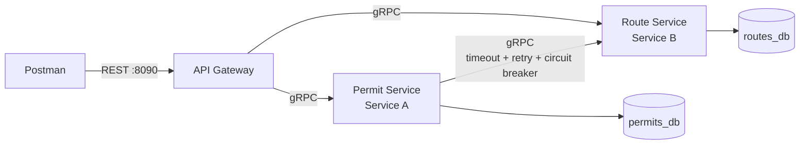

# Bhutan Trekking Permits: Two Collaborating Microservices

WEB303 Microservices & Serverless Applications, Programming Assignment
Wangchuk Gyeltshen (02240370), College of Science and Technology

A small distributed system for issuing trekking permits in Bhutan. Trekkers apply for a **permit** on a **trekking route**. Each resource is owned by its own Go microservice with its own PostgreSQL database, and clients reach both through a single REST API Gateway.

| Role in handout | Service | Resource | Database |
|---|---|---|---|
| Service B (independent) | `route-service` | Trekking routes (e.g. Druk Path Trek) | `routes_db` |
| Service A (dependent) | `permit-service` | Trekking permits for a route | `permits_db` |
| API Gateway | `gateway` | REST entry point, forwards over gRPC | none |

## Architecture



- Postman only talks to the gateway.
- The gateway converts REST to gRPC and maps gRPC errors to HTTP status codes.
- Permit Service calls Route Service over gRPC to confirm a route exists and that the group size fits, and to add route details when permits are read.
- Each service reads and writes only its own database (Database per Service). `permits_db` has no `routes` table; route data is only available through Route Service's gRPC API.

## Tech stack

Go 1.27, gRPC + Protocol Buffers, PostgreSQL 16, `pgx` driver, `sony/gobreaker` circuit breaker, Docker multi-stage builds, Docker Compose.

## Project structure

```
.
├── proto/
│   ├── route/route.proto          # Route Service contract (+ generated *.pb.go)
│   └── permit/permit.proto        # Permit Service contract (+ generated *.pb.go)
├── route-service/                 # Service B
│   ├── main.go                    # config from env, DB connection, gRPC server
│   ├── server.go                  # gRPC handlers, validation, error codes
│   ├── repository.go              # SQL for routes_db
│   └── Dockerfile
├── permit-service/                # Service A
│   ├── main.go
│   ├── server.go                  # handlers, validation, fallback response
│   ├── routeclient.go             # resilient gRPC client to Route Service
│   ├── repository.go              # SQL for permits_db
│   └── Dockerfile
├── gateway/
│   ├── main.go                    # HTTP routes, JSON decoding, server
│   ├── routes.go                  # /routes handlers
│   ├── permits.go                 # /permits handlers
│   ├── errors.go                  # gRPC -> HTTP status mapping
│   └── Dockerfile
├── postman/Trekking-Permits-API.postman_collection.json
├── docker-compose.yml
├── .env.example
└── go.mod
```

## How to run

Requirements: Docker Desktop (with Docker Compose).

```bash
# 1. Create your local config from the example (Windows: copy .env.example .env)
cp .env.example .env

# 2. Build and start everything (2 databases, 2 services, gateway)
docker compose up --build -d

# 3. Check all 5 containers are running
docker compose ps

# 4. Check the gateway
curl http://localhost:8090/health
```

The gateway listens on **http://localhost:8090**. Stop everything with `docker compose down` (add `-v` to also delete the database volumes).

`.env` is git-ignored so real secrets are never committed. `.env.example` contains working demo values for local use only.

## Configuration (environment variables)

No ports, addresses or database details are hard-coded. Everything comes from `.env` through `docker-compose.yml`.

| Variable | Default | Used by | Meaning |
|---|---|---|---|
| `GATEWAY_HTTP_PORT` | 8090 | gateway | REST port |
| `GATEWAY_REQUEST_TIMEOUT_MS` | 10000 | gateway | deadline for each downstream gRPC call |
| `ROUTE_GRPC_PORT` | 50051 | route-service | gRPC port |
| `PERMIT_GRPC_PORT` | 50052 | permit-service | gRPC port |
| `ROUTE_DB_*`, `PERMIT_DB_*` | see `.env.example` | each service + its DB | database name, user, password |
| `ROUTE_TIMEOUT_MS` | 2000 | permit-service | timeout per call to Route Service |
| `ROUTE_MAX_ATTEMPTS` | 3 | permit-service | total attempts (1 + 2 retries) |
| `ROUTE_BACKOFF_MS` | 200 | permit-service | first retry delay, doubled each retry |
| `CB_FAILURE_THRESHOLD` | 3 | permit-service | consecutive failures that open the breaker |
| `CB_OPEN_SECONDS` | 15 | permit-service | how long the breaker stays open |

## REST API (via the gateway)

| Method | URL | Description | Success |
|---|---|---|---|
| GET | `/health` | Gateway health check | 200 |
| POST | `/routes` | Create a route | 201 |
| GET | `/routes` | List routes | 200 |
| GET | `/routes/{id}` | Get a route | 200 |
| PUT | `/routes/{id}` | Update a route | 200 |
| DELETE | `/routes/{id}` | Delete a route | 200 |
| POST | `/permits` | Create a permit (checks route via gRPC) | 201 |
| GET | `/permits` | List permits (with route details) | 200 |
| GET | `/permits/{id}` | Get a permit (with route details) | 200 |
| PUT | `/permits/{id}` | Update a permit (checks route via gRPC) | 200 |
| DELETE | `/permits/{id}` | Delete a permit | 200 |

Example: create a route, then a permit for it.

```json
POST /routes
{ "name": "Druk Path Trek", "dzongkhag": "Paro", "difficulty": "MODERATE",
  "duration_days": 6, "max_altitude_m": 4235, "max_group_size": 12 }

POST /permits
{ "route_id": 1, "trekker_name": "Wangchuk Gyeltshen", "email": "wangchuk@example.com",
  "group_size": 4, "start_date": "2026-11-15" }
```

### gRPC to HTTP error mapping

| gRPC code | HTTP | Example |
|---|---|---|
| `INVALID_ARGUMENT` | 400 | invalid fields, route does not exist, group too large |
| `NOT_FOUND` | 404 | `GET /routes/999` |
| `ALREADY_EXISTS` | 409 | duplicate route name |
| `UNAVAILABLE` | 503 | Route Service down or circuit breaker open |
| `DEADLINE_EXCEEDED` | 504 | gateway deadline reached |
| other | 500 | internal errors |

Error bodies look like `{"status": 404, "grpc_code": "NotFound", "error": "route not found"}`.

## Validation

All input is validated before anything is stored; every problem is reported in one 400 response.

- **Gateway:** malformed JSON, wrong field types and unknown fields are rejected; `{id}` must be a positive integer.
- **Route Service:** name required (max 100 chars, unique), dzongkhag required, difficulty `EASY`/`MODERATE`/`HARD`, duration 1 to 60 days, altitude 500 to 8000 m, group size 1 to 50.
- **Permit Service:** positive `route_id`, name 2 to 100 chars, valid email, group size 1 to 50, `start_date` in `YYYY-MM-DD` and not in the past (on create), status `PENDING`/`APPROVED`/`CANCELLED` (on update). It also asks Route Service whether the route exists and whether `group_size` is within the route's `max_group_size`.

## Resilience (Permit Service to Route Service)

Implemented in `permit-service/routeclient.go`. Each call goes through three layers:

1. **Timeout:** every attempt has its own deadline (`ROUTE_TIMEOUT_MS`), so a slow Route Service cannot make requests hang.
2. **Retry with exponential backoff:** only transient errors (`UNAVAILABLE`, `DEADLINE_EXCEEDED`, ...) are retried, waiting 200 ms then 400 ms. Real answers such as `NOT_FOUND` are not retried.
3. **Circuit breaker:** after 3 consecutive failed calls the breaker opens and calls fail fast for 15 s, then it goes half-open and a successful trial call closes it again. `NOT_FOUND` does not count as a failure.

Behaviour when Route Service is stopped:

| Request | Result |
|---|---|
| `GET /permits/{id}`, `GET /permits` | **200 fallback**: permit data with `"route_lookup": "FALLBACK: Route Service is unavailable, route details omitted"` |
| `POST /permits`, `PUT /permits/{id}` | **503**, nothing is stored (the route cannot be verified) |
| after 3 failures | **503** `circuit breaker open`, returned in a few ms |

### Demonstrating it

```bash
docker compose stop route-service     # simulate failure
# send GET /permits/1 and POST /permits a few times in Postman
docker compose logs --tail 20 permit-service   # retries and "closed -> open"
docker compose start route-service    # recover; after 15 s: "open -> half-open -> closed"
```

## Testing with Postman

Import `postman/Trekking-Permits-API.postman_collection.json`. The collection variable `baseUrl` is `http://localhost:8090`. It contains 18 requests in **Routes** and **Permits** folders, covering full CRUD plus the error cases (invalid data, not found, duplicate, route does not exist, group too large, malformed JSON). Run the create requests first so IDs 1 and 3 exist.

## Regenerating the gRPC code

```bash
go install google.golang.org/protobuf/cmd/protoc-gen-go@latest
go install google.golang.org/grpc/cmd/protoc-gen-go-grpc@latest
protoc --go_out=. --go_opt=module=trekking \
       --go-grpc_out=. --go-grpc_opt=module=trekking \
       proto/route/route.proto proto/permit/permit.proto
```